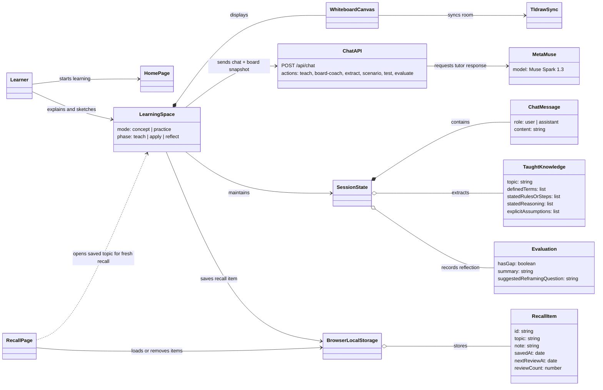

# CONCAT UML overview

This conceptual UML class diagram shows the main application modules and the data they exchange. The app is implemented with Next.js components and API routes; these are not JavaScript classes.

The whiteboard snapshot is captured when the learner sends a message or when CONCAT reviews the board after a pause. The recall queue stores a topic and note so the learner can revisit the idea with a fresh prompt; it does not store or replay the full chat transcript.
